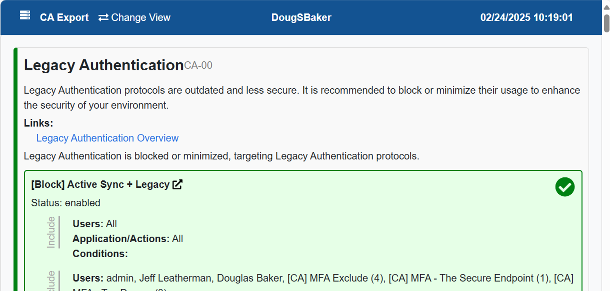
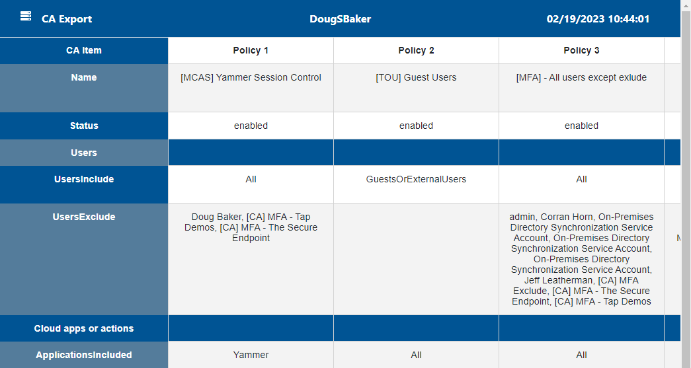
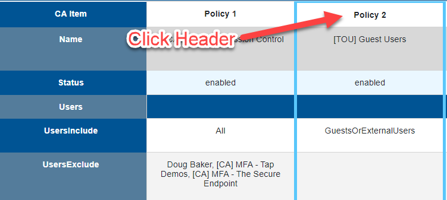

# CA-Export

Exports Microsoft Entra ID Conditional Access policies to a self-contained interactive HTML report. The recommended script (`Export-CAPolicyWithRecs.ps1`) goes further by evaluating your policies against 13 security checks and surfacing actionable recommendations.

---

## Quick Start

```powershell
.\Export-CAPolicyWithRecs.ps1
```

That's it. The script connects to Microsoft Graph automatically, collects your policies, resolves all GUIDs to display names, runs the security checks, and opens `CAPolicy.html` in your default browser.

To switch tenants between runs:

```powershell
Disconnect-MgGraph
```

To export a single policy by GUID:

```powershell
.\Export-CAPolicyWithRecs.ps1 -PolicyID 'xxxxxxxx-xxxx-xxxx-xxxx-xxxxxxxxxxxx'
```

---

## Why Use the Recommendations Script?

The plain export (`Export-CaPolicy.ps1`) gives you a sortable pivot table of all your CA policies — useful for documentation and external review. The recommendations script does everything the plain export does and adds a color-coded security review panel that tells you exactly where your CA coverage has gaps.

Each check produces a **pass (green)** or **warning (orange)** card with a description, affected policies, and a link to the relevant Microsoft Learn documentation.




---

## Security Checks (CA-00 through CA-12)

| ID | Check |
|----|-------|
| CA-00 | Block Legacy Authentication |
| CA-01 | MFA policy targets All Users and All Cloud Apps |
| CA-02 | Mobile device policy requires MDM or MAM |
| CA-03 | Require Hybrid Join or Intune Compliance for Windows/Mac |
| CA-04 | Require MFA for Admins |
| CA-05 | Require Phish-Resistant MFA for Admins |
| CA-06 | Policy excludes the same entities it includes (misconfiguration) |
| CA-07 | Policy has no users targeted (dead policy) |
| CA-08 | Direct user assignment in policy (should use groups) |
| CA-09 | Risk-based policy in place |
| CA-10 | Block Device Code Flow |
| CA-11 | Require MFA to enroll a device in Intune |
| CA-12 | Block unknown or unsupported devices |

---

## Requirements

**PowerShell module:**

```powershell
Install-Module Microsoft.Graph
```

If you have multiple versions of `Microsoft.Graph` installed, the script will warn you and exit. Fix it with:

```powershell
Update-Module Microsoft.Graph -Force
```

Then close and reopen your terminal before re-running.

**Graph permissions required:**

- `Policy.Read.All`
- `Directory.Read.All`
- `Application.Read.All`
- `Agreement.Read.All`
- `GroupMember.Read.All`

---

## What the Report Shows

- **Policy table** — each policy is a column; rows are properties (state, users, apps, conditions, controls). Fixed header and first-column scrolling make large tenants readable. Click a column to highlight it.
- **Recommendations panel** — one card per check, color-coded pass/warning, with affected policy names and a link to Microsoft Learn docs.



---

## Script Reference

| Script | Purpose |
|--------|---------|
| `Export-CAPolicyWithRecs.ps1` | Policy table + 13 security checks. **Recommended.** |
| `Export-CaPolicy.ps1` | Policy table only. Useful for lightweight documentation exports. |

Both scripts write `CAPolicy.html` to the script directory and open it automatically. JSON export is available but off by default (`$JsonExport = $false` near the top of each script).

---

### License

Shield: [![CC BY-NC-SA 4.0][cc-by-nc-sa-shield]][cc-by-nc-sa]

This work is licensed under a
[Creative Commons Attribution-NonCommercial-ShareAlike 4.0 International License][cc-by-nc-sa].

[![CC BY-NC-SA 4.0][cc-by-nc-sa-image]][cc-by-nc-sa]

[cc-by-nc-sa]: http://creativecommons.org/licenses/by-nc-sa/4.0/
[cc-by-nc-sa-image]: https://licensebuttons.net/l/by-nc-sa/4.0/88x31.png
[cc-by-nc-sa-shield]: https://img.shields.io/badge/License-CC%20BY--NC--SA%204.0-lightgrey.svg
